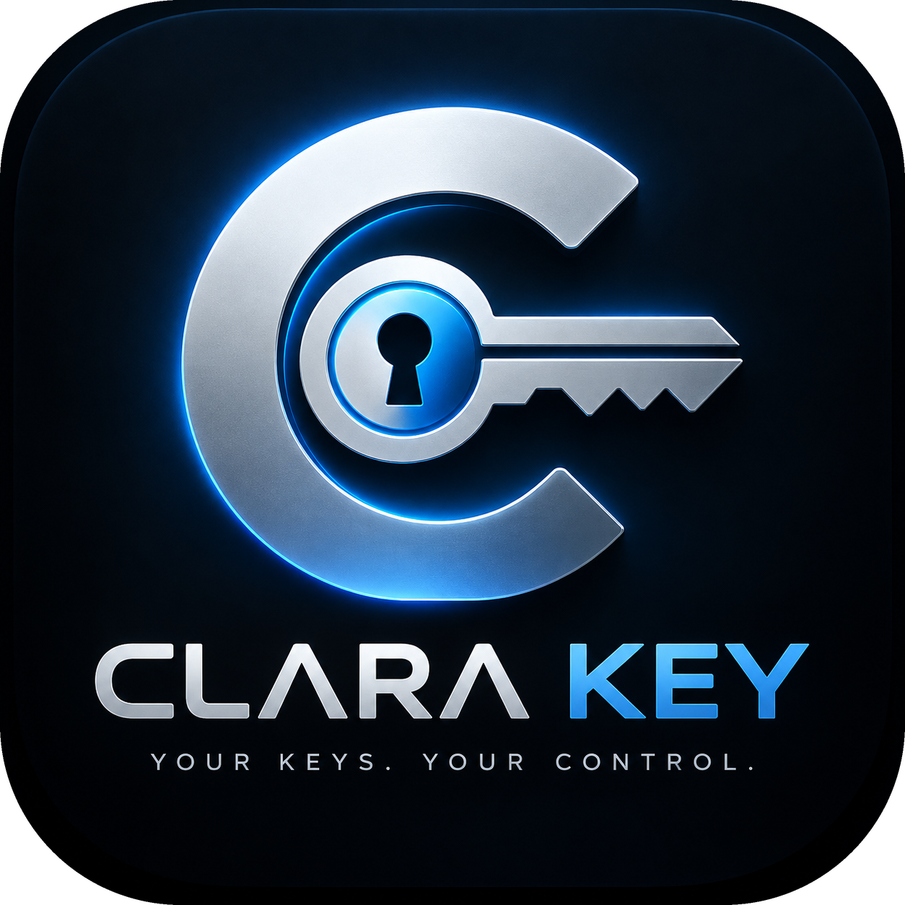

<p align="center"></p>

# ClaraKey

A portable, local-first encrypted authentication vault for Linux. Carry TOTP
accounts, recovery codes, API tokens, SSH private keys, passwords and private notes
on an ordinary USB drive. No cloud, account, telemetry, analytics, subscription or
network service is part of ClaraKey. Normal operation is offline.

**Release status:** 1.3.0 adds drag-and-drop for files (see [Files](#files)). 1.2.0 added the new logo
and a one-click PC icon (see
[Open it with one click](#open-it-with-one-click)). 1.1.0 added encrypted file storage (see [Files](#files)). 1.0.1 was
[the desktop input fix](docs/DESKTOP_FIX_1.0.1.md). Backend tests and portable
runtime verification are automated, and the real GTK acceptance run passed on
2026-10-10 (Xvfb, GTK 4.22.4). Read [the exact test results](docs/TEST_RESULTS.md)
before entrusting real credentials. This is not an independently audited release.

## Features

* Native dark GTK desktop interface, with metadata-only local search.
* TOTP with SHA-1/SHA-256/SHA-512, 6/7/8 digits, configurable 15–300 second periods,
  live countdown and copy. Manual and strict `otpauth://totp/` URI import.
* Recovery code editing, deletion, copy/reveal and used markers.
* API credentials; imported SSH private keys with explicit export; passwords with
  secure configurable generator; secure notes with created/modified timestamps.
* Encrypted files up to 1 MiB each (5 MiB per vault): signing keystores, certificates,
  GPG keys, wallet and 2FA backup files, with a SHA-256 fingerprint checked on every
  unlock and confirmed, no-overwrite saving back out.
* Masked secret details, clipboard ownership-aware timeouts and inactivity lock.
* Authenticated encryption of all entries, metadata and settings.
* Verified atomic encrypted saves, previous-revision recovery, encrypted backups
  and validated/confirmed restore. Explicit warning/confirmation for plaintext export.

ClaraKey is a software vault. It is not FIDO2/WebAuthn hardware, a TPM, secure
element, YubiKey replacement or protection from a compromised computer. QR image
import, browser integration, synchronization and non-Linux platforms are not part
of this release.

## Files

The quickest way: unlock ClaraKey and **drag files onto its window** from your file manager. Each one is
stored right away, titled with its name (two files with the same name get their folder added, for example
`keystore.properties (.clara-release)`), all in one encrypted save. Folders and files over the limit are
skipped with a note in the status bar. Or choose **Files → Add entry**, browse to the file (the browser has
Home, Desktop, Downloads, Documents and This drive shortcuts, and shows hidden folders) and optionally add a
title and notes. The
file's bytes, name and notes are encrypted inside the vault like every other entry;
the original stays where it was. **Save file…** writes an exact unencrypted copy after
a confirmation, with owner-only permissions, and never overwrites an existing file.

Each file is limited to 1 MiB and all files in a vault to 5 MiB, because the whole
vault is one encrypted payload of at most 8 MiB that is rewritten on every save. That
holds many keystores and certificates; keep large documents in an encrypted archive.
A vault becomes payload schema 2 when it holds a file. ClaraKey 1.0.x refuses such a
vault without changing it; vaults without files keep schema 1 and still open in 1.0.x.

## Quick start: portable release

Extract `dist/ClaraKey-linux-x86_64.tar.gz` onto a writable USB drive. Keep the entire
`ClaraKey` directory together, including its `runtime` and `app` folders. Run:

```sh
cd /path/to/USB/ClaraKey
./ClaraKey
```

The bundle includes Python, GTK and cryptographic runtime dependencies. It targets
Linux x86_64 and still needs a working Wayland or X11 desktop and the host kernel.
Only the build host has been tested; this is not a universal distribution guarantee.
A USB filesystem mounted `noexec` will prevent running binaries from that drive;
use a trusted executable mount or run the application from a trusted host location
with an explicitly selected portable directory. On filesystems without Unix
permissions, mount options govern executability. No automatic privileged changes
are made by the scripts.

Default portable layout:

```text
ClaraKey/
  ClaraKey                  executable launcher
  AppRun                    equivalent AppImage launcher
  app/                      application source
  runtime/                  bundled Python and native libraries
  vault/clarakey.vault       encrypted vault, created on first use
  vault/.previous.vault      encrypted previous revision
  backups/                  encrypted timestamped backups
  .clarakey.lock             empty process-lock file
  README.txt
```

An existing `clarakey.vault` beside the executable is also supported. Otherwise,
a new vault is created in `vault/`. ClaraKey resolves the application directory,
not the terminal working directory. `--portable-dir /absolute/path` explicitly
selects a different existing portable directory for development or recovery; it
never silently falls back to the host home directory.

## Open it with one click

Run this once from the `ClaraKey` folder on your drive:

```sh
./add-to-this-pc.sh --pin
```

It adds a **ClaraKey** icon to the app grid and pins it to the GNOME dock. Clicking it mounts the drive if
needed and starts the ClaraKey on it; if the drive isn't plugged in, it says so. The PC gets only a small
launcher script, a desktop entry and the icon, never the vault. No administrator rights are used.
`./add-to-this-pc.sh --remove` takes it off again. Without `--pin` the icon goes in the app grid only.

Recent Ubuntu releases no longer mount ext4 USB drives automatically (a rule in `e2fsprogs`), so a drive
can't offer to start ClaraKey on its own when plugged in; the icon does the mounting instead.

## Create and use a vault

1. Launch ClaraKey. Choose **Create New Vault** and enter/confirm a unique master
   password of at least 12 characters. Prefer several randomly chosen words.
2. Read the recovery warning: **If you lose this password, ClaraKey cannot recover
   your vault.** There is no backdoor or password recovery service.
3. Choose **Authenticator → Add entry**. Enter service, account and Base32 secret,
   or paste the account's `otpauth://totp/` URI. Parameters in the URI are honored.
4. Save. The current code and countdown appear immediately; **Copy code** uses the
   configured clipboard timeout. TOTP relies on an accurate host clock; ClaraKey
   does not contact a time server or change your clock.
5. Select another collection to add passwords, recovery codes, API credentials,
   SSH keys or notes. Open an entry to reveal, copy, edit, delete or explicitly
   export it. Editing a secret is an explicit reveal operation.
6. Click **Lock Vault** before ejecting the USB using the operating system's eject
   action. Close ClaraKey before unplugging. Saves occur immediately, not on exit.

Recovery codes are entered one per line. In the editor, prefix a used code with
`[used] `; in the detail view use the **Used** checkbox. SSH import reads local
OpenSSH/PEM files; an imported passphrase-protected key keeps that extra protection.
No key is installed into `~/.ssh`. Exporting SSH writes the selected private-key
text; other entry exports use JSON. Exports must use a new filename and are never
automatically overwritten.

The password generator uses the operating system CSPRNG through Python `secrets`,
not a simulation PRNG. Choose 8–128 characters and enabled uppercase, lowercase,
numeric and symbol groups. Every selected group is represented.

## Locking and clipboard

Defaults are 5 minutes of inactivity and 30 seconds of clipboard lifetime. Settings
offer 1/5/10/30 minutes/never for idle lock and 15/30/60 seconds/never for clipboard.
Inactivity timing includes Linux suspend. Clipboard ownership, not just equal text,
is checked before clearing; newer copies from other applications are preserved.
Explicit lock/exit clears ClaraKey-owned clipboard data even with the timer disabled.
Clipboard managers, applications receiving pasted secrets and operating-system
history may retain their own copies; ClaraKey cannot revoke them.

Decrypted state is discarded, widgets cleared, mutable key buffers overwritten and
UI dialogs closed on lock. Python and GTK can retain immutable copies in memory;
complete memory erasure is not claimed. Core dumps are disabled by the launcher.
Use trusted hosts with encrypted swap and disk encryption.

## Backups and recovery

In **Settings & backups**, select **Create Backup**. A unique encrypted
`clarakey-backup-YYYY-MM-DD-HHMMSS-<random>.vault` is saved under `backups/`. Keep a
second encrypted copy on another physical drive; copies on the same USB do not
protect against loss or hardware failure.

Choose **Restore Backup**, select a local backup using the built-in file browser,
and enter the password used to encrypt that backup. **Validate Backup** must succeed
before the confirmation checkbox enables **Restore validated backup**. While
unlocked, the current vault is backed up first and its master password is retained.
From the locked screen, the restored vault uses the backup's master password.
A previous revision is retained when replacing an existing vault.

After an interrupted save, the same dialog offers `.previous.vault` and surviving
encrypted pending files. Validate candidates individually; do not assume a pending
file is complete. An uncertain write must be resolved by reopening the application.
ClaraKey will not erase a vault for failed password attempts. Increasing delays
begin after three failures, capped at 60 seconds. These process-local delays can
be bypassed by restarting or attacking a copy of the file; Argon2id and the master
password are the offline brute-force defense.

## Build and development

Required: Linux, Python 3.11+, GTK 4 with PyGObject, and PyCA `cryptography` 44+
with a working Argon2id backend. The current build uses Python 3.14.4, GTK 4.22.4,
PyCA 46.0.5. Build scripts use installed packages and never run `sudo`.

```sh
./setup.sh                # verify installed dependencies and cryptographic support
./dev.sh                  # run from source; stores vault beside the source launcher
./test.sh                 # unit tests, process acceptance, real GTK/Xvfb acceptance
./build.sh                # build and smoke-test bundled Linux directory + tar.gz
./build.sh --appimage     # additionally package with installed official appimagetool
```

For Debian/Ubuntu with sufficiently recent packages, the package names are
`python3`, `python3-gi`, `gir1.2-gtk-4.0`, `python3-cryptography`, `python3-cairo`,
`python3-cffi-backend` and `python3-typing-extensions`. GUI tests need `xvfb`, `xauth`
and a permitted local display socket. Packaging needs `libc-bin` (`ldd`) and
`dpkg-query`; optional AppImage tooling needs its official runtime and
`squashfs-tools`. `setup.sh` reports missing prerequisites without installing
system packages. No dependency download is required on this supplied environment.

Headless checks can be run independently:

```sh
python3 -B -m unittest discover -s tests -v
python3 -B tests/process_acceptance.py
```

`./test.sh` deliberately returns failure when GUI testing is blocked; it does not
silently count that as a pass. The portable build is offline and includes an
inventory and SHA-256 manifest. Before publishing binaries, review bundled
third-party licensing/source obligations in `THIRD_PARTY.txt` and `licenses/`.
The bundler refuses to replace an output folder containing a vault or backups.

## AppImage status

The application directory and archive are the primary portable release artifacts.
This environment does not contain `appimagetool` or its official runtime and cannot
download them, so **no AppImage is claimed or supplied**. `build.sh --appimage`
produces the directory first, reports the missing tool, and exits 2. Once the
packager is installed, it targets `dist/ClaraKey.AppImage`. `AppRun` resolves
`APPIMAGE` so the vault is stored beside the image, outside its read-only mount.
AppImage packaging and FUSE/extraction portability still require validation.

## Security and project layout

See [ARCHITECTURE.md](ARCHITECTURE.md), [VAULT_FORMAT.md](VAULT_FORMAT.md),
[THREAT_MODEL.md](THREAT_MODEL.md), [SECURITY.md](SECURITY.md), and
[the implementation review](docs/SECURITY_REVIEW.md).

```text
clarakey/
  clarakey/       crypto, schemas, TOTP, storage, session, policies, native UI/CSS
  tests/          security unit tests, process restart acceptance, GTK acceptance
  packaging/      portable bundler, launcher, verification, desktop/icon assets
  docs/           test results and security review
  run.py          hardened application entry point
  ClaraKey        source launcher
  setup.sh dev.sh test.sh build.sh
  dist/           generated portable directory/archive/checksum
```

To report vulnerabilities, follow [SECURITY.md](SECURITY.md). Never send a real
vault, password or authentication secret in a public issue. Source is MIT-licensed;
third-party components retain their own licenses.
